<h1 data-importer="text" align="center">👋 Hey there! I'm a Web Developer</h1>

I'm a passionate developer who enjoys building modern, responsive, and scalable web applications.

- 💻 Working with **Vue.js, Nuxt.js, and NestJS**
- 🚀 Building full-stack applications with **JavaScript and TypeScript**
- 🗄️ Experienced with **MySQL and PostgreSQL**
- 🎨 Interested in creating clean, intuitive, and user-friendly interfaces
- 🌱 Always learning, improving, and exploring new technologies

**I believe in writing clean code, solving problems, and continuously growing as a developer.**

###

  
  
  
  
  
  
  
  
  
  
  
  
  
  
  
  
  

###

  
  
  
  
  

###

  
  

###

<picture data-importer="pacman">
  <source media="(prefers-color-scheme: dark)" srcset="https://raw.githubusercontent.com/mjotohot/mjotohot/pacman-output/pacman-contribution-graph-dark.svg?game=pacman">
  <source media="(prefers-color-scheme: light)" srcset="https://raw.githubusercontent.com/mjotohot/mjotohot/pacman-output/pacman-contribution-graph.svg?game=pacman">
  
</picture>

###
